# BLACKHORNET Ω — COMPLETE SYSTEM DOCUMENTATION

> **Tanggal:** 2026-07-04
> **Versi:** 1.1.0
> **Mesin:** Lord Omega v6.0.1
> **Founder:** Mulky Malikul Dhaher

---

## DAFTAR ISI

1. [Arsitektur Sistem](#1-arsitektur-sistem)
2. [Boot Sequence](#2-boot-sequence)
3. [Main Loop (Pipeline Utama)](#3-main-loop-pipeline-utama)
4. [Semua Workflow](#4-semua-workflow)
5. [Semua Module & Cara Kerja](#5-semua-module--cara-kerja)
6. [Agent System](#6-agent-system)
7. [Consciousness Layers](#7-consciousness-layers)
8. [Memory System](#8-memory-system)
9. [Scoring System (100/100/100)](#9-scoring-system-100100100)
10. [Sync Pipeline](#10-sync-pipeline)
11. [Test System](#11-test-system)
12. [File-by-File Map](#12-file-by-file-map)
13. [Dependency Graph](#13-dependency-graph)
14. [Failure Modes & Recovery](#14-failure-modes--recovery)
15. [Docker Deployment](#15-docker-deployment)
16. [Quant Nanggroe AI Integration](#16-quant-nanggroe-ai-integration)
17. [Remote Repositories (3 Forges)](#17-remote-repositories-3-forges)
18. [OpenCode Persistent Memory](#18-opencode-persistent-memory)
19. [Push All Remotes Pipeline](#19-push-all-remotes-pipeline)

---

## 1. ARSITEKTUR SISTEM

```
┌──────────────────────────────────────────────────────────────────┐
│                    BLACKHORNET Ω ARCHITECTURE                    │
├──────────────────────────────────────────────────────────────────┤
│                                                                  │
│  ┌──────────────────────────────────────────────────────────┐   │
│  │              OMEGA ENGINE (src/omega/)                    │   │
│  │  ┌──────┐ ┌──────┐ ┌──────┐ ┌──────┐ ┌──────┐ ┌──────┐ │   │
│  │  │Engine│ │Const │ │ SCS  │ │Council│ │Pred  │ │Brain │ │   │
│  │  │      │ │itut  │ │      │ │      │ │ictor │ │      │ │   │
│  │  └──────┘ └──────┘ └──────┘ └──────┘ └──────┘ └──────┘ │   │
│  │  ┌──────┐ ┌──────┐ ┌──────┐ ┌──────┐ ┌──────┐ ┌──────┐ │   │
│  │  │Genome│ │Evol  │ │ Score│ │ Sync │ │Auto  │ │Consc │ │   │
│  │  │      │ │ution │ │      │ │      │ │Path  │ │Layers│ │   │
│  │  └──────┘ └──────┘ └──────┘ └──────┘ └──────┘ └──────┘ │   │
│  └──────────────────────────────────────────────────────────┘   │
│                              │                                    │
│  ┌──────────────────────────────────────────────────────────┐   │
│  │              AGENT LAYER (src/agents/)                    │   │
│  │  ┌──────┐ ┌──────┐ ┌──────┐ ┌──────┐ ┌──────┐ ┌──────┐ │   │
│  │  │Coder │ │Browse│ │Exec  │ │Plann │ │Manus │ │Resea │ │   │
│  │  │      │ │r     │ │utor  │ │er    │ │      │ │rcher │ │   │
│  │  └──────┘ └──────┘ └──────┘ └──────┘ └──────┘ └──────┘ │   │
│  │  ┌──────┐ ┌──────┐ ┌──────┐ ┌──────┐ ┌──────┐ ┌──────┐ │   │
│  │  │Colony│ │Secur │ │Audit*│ │ORCA  │ │Baby  │ │Spec  │ │   │
│  │  │      │ │ity   │ │(50+) │ │      │ │AGI   │ │ialist│ │   │
│  │  └──────┘ └──────┘ └──────┘ └──────┘ └──────┘ │(40+)│ │   │
│  │                                                 └──────┘ │   │
│  └──────────────────────────────────────────────────────────┘   │
│                              │                                    │
│  ┌──────────────────────────────────────────────────────────┐   │
│  │              TOOL LAYER (src/agent_tools/)                │   │
│  │  Browser│Code│Channel│Docker│File│MCP│Memory│Search│     │   │
│  │  Shell│Voice│TradingView│Registry│Base                   │   │
│  └──────────────────────────────────────────────────────────┘   │
│                              │                                    │
│  ┌──────────────────────────────────────────────────────────┐   │
│  │              MEMORY & INFRASTRUCTURE                      │   │
│  │  ┌──────┐ ┌──────┐ ┌──────┐ ┌──────┐ ┌──────┐ ┌──────┐ │   │
│  │  │STM   │ │ LTM  │ │Episod│ │Vect  │ │Second│ │Conf  │ │   │
│  │  │      │ │      │ │ic    │ │or    │ │Brain │ │ig    │ │   │
│  │  └──────┘ └──────┘ └──────┘ └──────┘ └──────┘ └──────┘ │   │
│  └──────────────────────────────────────────────────────────┘   │
│                                                                  │
│  ┌──────────────────────────────────────────────────────────┐   │
│  │              BRIDGES (src/bridges/)                       │   │
│  │  ┌──────────────────┐  ┌──────────────────────────────┐  │   │
│  │  │  TS Bridge        │  │  Hermes Nous (src/hermes/)  │  │   │
│  │  │  (AO compatibility)│  │  8+1 Consciousness Layers  │  │   │
│  │  └──────────────────┘  └──────────────────────────────┘  │   │
│  └──────────────────────────────────────────────────────────┘   │
│                                                                  │
│  ┌──────────────────────────────────────────────────────────┐   │
│  │              EXTERNAL INTEGRATIONS                        │   │
│  │  ┌──────┐ ┌──────┐ ┌──────┐ ┌──────┐ ┌──────┐ ┌──────┐ │   │
│  │  │Codebg│ │GitHub│ │Docker│ │LLM   │ │Hermes│ │Quant │ │   │
│  │  │      │ │      │ │      │ │APIs  │ │Nous  │ │Trad  │ │   │
│  │  └──────┘ └──────┘ └──────┘ └──────┘ └──────┘ └──────┘ │   │
│  └──────────────────────────────────────────────────────────┘   │
│                                                                  │
└──────────────────────────────────────────────────────────────────┘
```

---

## 2. BOOT SEQUENCE

Setiap session, BH menjalankan boot sequence ini:

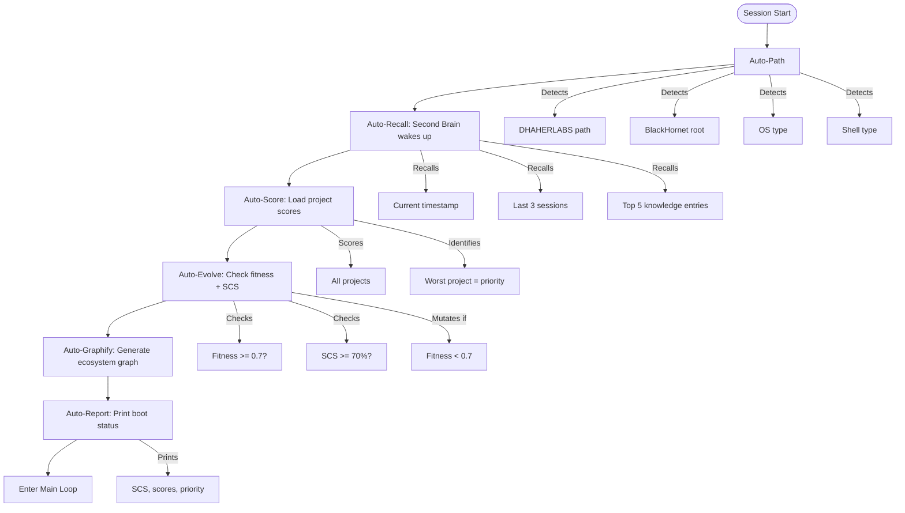

**Kode:** `src/omega/__init__.py :: OmegaEngine.boot()`
```python
def boot(self) -> dict:
    # 1. Auto-Path: detect semua path dinamis
    # 2. Auto-Recall: Second Brain wake_up()
    # 3. Auto-Score: ProjectScorer.current()
    # 4. Auto-Evolve: SelfConfidenceSystem.status()
    # 5. Auto-Report: return dict dengan semua status
```

---

## 3. MAIN LOOP (Pipeline Utama)

Loop utama BH berjalan terus menerus:

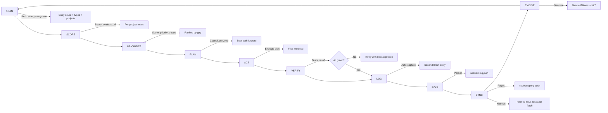

**Kode:** `src/omega/__init__.py :: OmegaEngine.main_loop()`
```python
def main_loop(self) -> dict:
    loop_report = {}
    loop_report["scan"] = brain.scan_ecosystem()
    loop_report["score"] = scorer.evaluate_all()
    loop_report["priority"] = scorer.priority_queue()
    council_result = council.convene(context, personas)
    loop_report["council"] = council_result
    sync.run()
    brain.auto_capture("session", f"Loop #{n} completed")
    return loop_report
```

---

## 4. SEMUA WORKFLOW

### 4.1 Self-Confidence Workflow
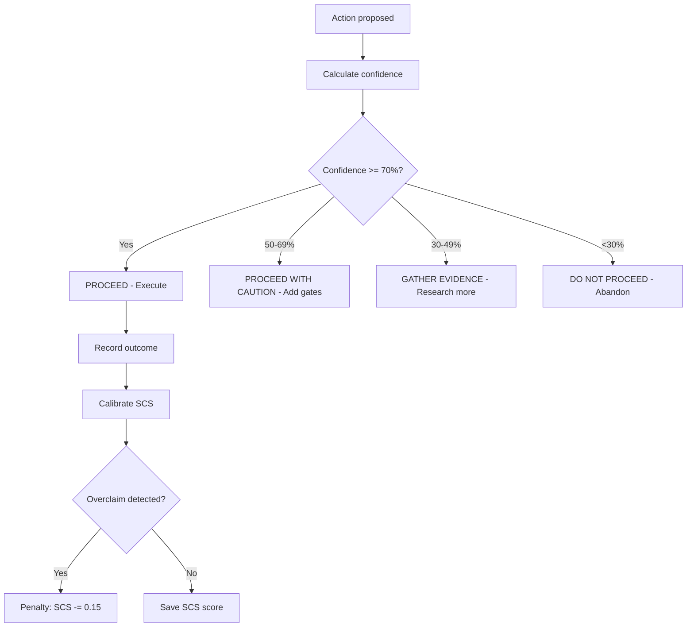

**Kode:** `src/omega/scs.py :: SelfConfidenceSystem`

### 4.2 Council Workflow
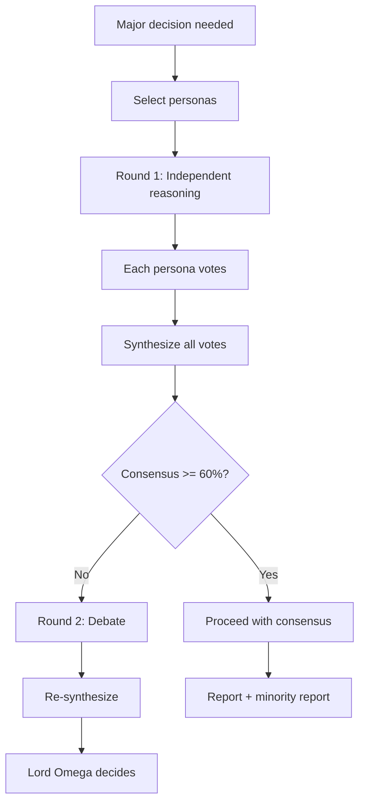

**Kode:** `src/omega/council.py :: Council`

### 4.3 Prediction Workflow (L9 Oracle)
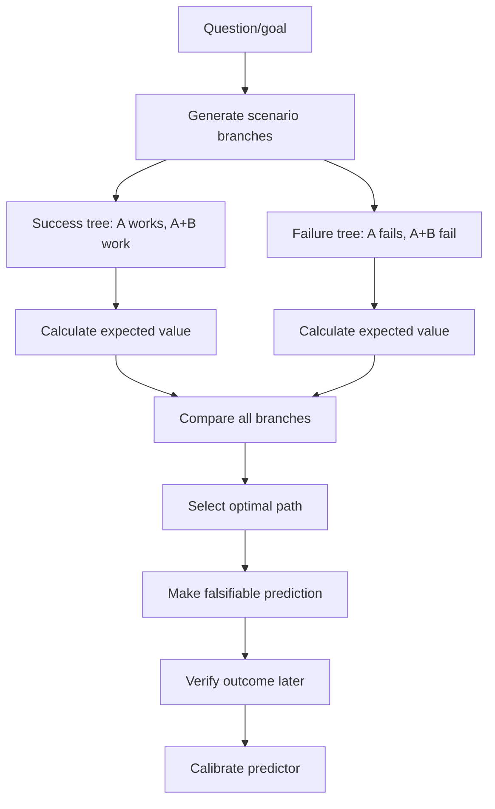

**Kode:** `src/omega/predictor.py :: PredictiveSuperconsciousness`

### 4.4 BabyAGI Task Loop
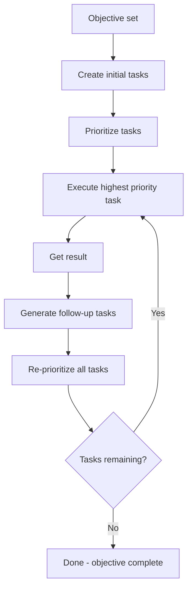

**Kode:** `src/agents/babyagi.py :: BabyAGI`

### 4.5 ORCA Parallel Agent Workflow
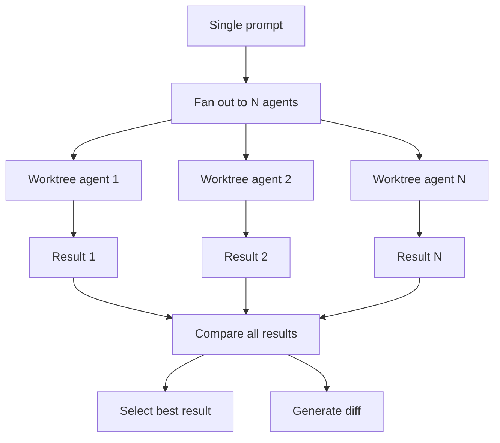

**Kode:** `src/agents/orca.py :: OrcaOrchestrator`

### 4.6 Sync Pipeline
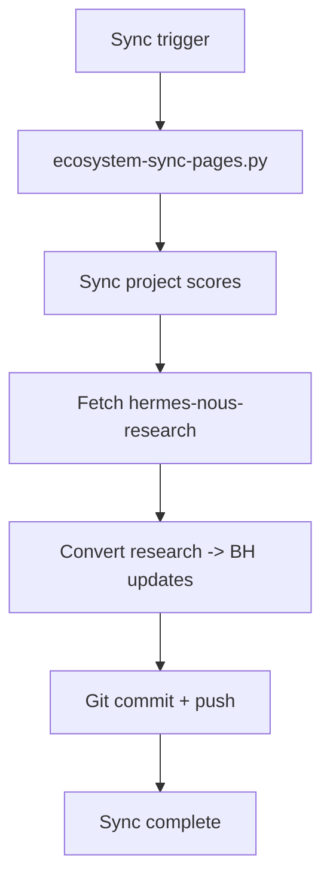

**Kode:** `src/omega/sync.py :: EcosystemSync`

---

## 5. SEMUA MODULE & CARA KERJA

### 5.1 Omega Engine (src/omega/)

| File | Lines | Class | Fungsi Utama | Cara Kerja |
|------|-------|-------|-------------|------------|
| `__init__.py` | 97 | `OmegaEngine` | `boot()`, `main_loop()`, `start()`, `stop()` | Boot sequence + autonomous main loop. Panggil `.boot()` untuk start, `.main_loop()` untuk iterasi |
| `constitution.py` | 85 | `Constitution` | `validate()`, `check_doc()` | Scan root docs + core docs. Hitung constitution score (max 25) |
| `scs.py` | 150 | `SelfConfidenceSystem` | `record_action()`, `calculate_score()`, `check_overclaim()`, `action_confidence()` | Track semua action + prediction. Hitung SCS = pred_accuracy×0.4 + calibration×0.3 + success_rate×0.2 + self_correction×0.1 |
| `council.py` | 118 | `Council` | `convene()`, `history()` | 15 personas debate parallel. Masing-masing vote dengan weight. Synthesis + minority report |
| `predictor.py` | 93 | `PredictiveSuperconsciousness` | `branch()`, `predict()`, `calibrate()` | Generate success/failure branches. Hitung EV. Pilih optimal path. Falsifiable prediction |
| `brain.py` | 131 | `SecondBrain` | `auto_capture()`, `recall_recent()`, `recall_search()`, `wake_up()`, `log_session()` | Auto-capture semua ke JSON. Persist across sessions. Recall at boot |
| `genome.py` | 98 | `GenomeEngine` | `evaluate_fitness()`, `mutate()`, `status()` | Traits evolution. Mutate random weights when fitness < 0.7 |
| `evolution.py` | 94 | `EvolutionEngine` | `record()`, `fitness_trend()`, `weak_dimensions()`, `evolve()` | Track fitness history. Identifikasi weak dimensions. Trigger genome mutation |
| `score.py` | 102 | `ProjectScorer` | `score()`, `evaluate_all()`, `priority_queue()`, `current()` | 100/100/100 scoring: Constitution 25 + Quality 50 + Operations 25 |
| `sync.py` | 78 | `EcosystemSync` | `run()`, `status()` | Pages sync + Hermes Nous fetch + score sync |
| `autopath.py` | 62 | `AutoPath` | `dhaherlabs()`, `blackhornet()`, `all()` | Dynamic path detection via env var, git, cwd |

### 5.2 Hermes Nous (src/hermes_nous/)

| File | Lines | Class | Fungsi Utama | Cara Kerja |
|------|-------|-------|-------------|------------|
| `layers.py` | 136 | `ConsciousnessLayers` | `activate()`, `run_layer()`, `status()` | 8+1 consciousness layers. Masing-masing layer punya runner function |
| `converter.py` | 107 | `HermesNousConverter` | `scan_research()`, `convert_file()`, `convert_all()` | Scan hermes-nous-research repo. Convert file ke BH module updates |

### 5.3 Bridges (src/bridges/)

| File | Lines | Class | Fungsi Utama | Cara Kerja |
|------|-------|-------|-------------|------------|
| `ts_bridge.py` | 121 | `TypeScriptBridge` | `connect()`, `send()`, `receive()`, `on()` | Bridge message protocol. Compatible dengan AO TS BaseBridge pattern |

### 5.4 Agents (src/agents/)

| File | Lines | Kelas | Fungsi | Cara Kerja |
|------|-------|-------|--------|------------|
| `base.py` | 658 | `BaseAgent`, `ToolCallingAgent` | `initialize()`, `execute_task()`, `run()` | Abstract base untuk semua agent. Tool calling + task execution |
| `coder.py` | 472 | `CoderAgent` | `generate_code()`, `_generate_with_reflexion()` | Generate + reflexion loop untuk code tasks |
| `browser.py` | 298 | `BrowserAgent` | `browse()`, `click()`, `extract()` | Web browsing + data extraction |
| `executor.py` | 322 | `ExecutorAgent` | `execute()`, `run_command()` | Execute shell commands + scripts |
| `planner.py` | 270 | `PlannerAgent` | `plan()`, `decompose()` | Task decomposition + planning |
| `manus.py` | 251 | `ManusAgent` | `execute_task()` | General purpose agent |
| `researcher.py` | 413 | `ResearchAgent` | `research()`, `search()` | Web research + synthesis |
| `colony.py` | 411 | `ColonyAgent` | `spawn()`, `coordinate()` | Multi-agent colony coordination |
| `security.py` | 382 | `SecurityAgent` | `scan()`, `audit()` | Security scanning + audit |
| `registry.py` | 294 | `AgentRegistry` | `register()`, `get()`, `list()` | Central agent registry |
| `graph.py` | 579 | `AgentGraph` | `add_node()`, `add_edge()`, `run()` | Agent workflow graph |
| `state.py` | 331 | `AgentState` | `get_state()`, `update_state()` | Agent state management |
| `orca.py` | 132 | `OrcaOrchestrator` | `race()`, `fan_out()`, `create_worktree()` | Parallel agent orchestration dengan worktree isolation |
| `babyagi.py` | 111 | `BabyAGI` | `run_loop()`, `execute_next()`, `prioritize()` | Task-driven autonomous loop: create → prioritize → execute |

### 5.5 Audit Agents (src/agents/audit/)

50+ audit agents specializing in different domains:
- Security: `security_audit_agent.py`, `authentication_audit_agent.py`, `authorization_audit_agent.py`, `encryption_audit_agent.py`, `penetration_test_agent.py`
- Infrastructure: `cloud_audit_agent.py`, `container_audit_agent.py`, `kubernetes_audit_agent.py`, `network_audit_agent.py`
- Code: `code_quality_audit_agent.py`, `test_coverage_audit_agent.py`, `dependency_audit_agent.py`
- Operations: `cicd_audit_agent.py`, `deployment_audit_agent.py`, `monitoring_audit_agent.py`
- Business: `compliance_audit_agent.py`, `risk_assessment_agent.py`, `disaster_recovery_agent.py`

### 5.6 Specialist Agents (src/agents/specialists/)

40+ specialist agents untuk domain-specific tasks:
- `frontend_ui_specialist.py`, `backend_api_specialist.py`, `database_specialist.py`
- `devops_specialist.py`, `cicd_specialist.py`, `cloud_specialist.py`
- `security_specialist.py`, `compliance_specialist.py`, `risk_management_specialist.py`
- `ml_specialist.py`, `data_engineering_specialist.py`, `analytics_specialist.py`
- `kubernetes_specialist.py`, `container_specialist.py`, `serverless_specialist.py`

### 5.7 Agent Tools (src/agent_tools/)

25 tool files:
- `base.py` — Base tool class
- `browser.py`, `browser_tool.py` — Browser automation
- `code.py`, `code_tool.py` — Code generation
- `channel.py`, `channel_tool.py` — Multi-channel messaging
- `docker.py`, `docker_tool.py` — Docker operations
- `file.py`, `file_tool.py` — File operations
- `memory.py`, `memory_tool.py` — Memory operations
- `search.py`, `search_tool.py` — Web search
- `shell.py`, `shell_tool.py` — Shell execution
- `voice.py`, `voice_tool.py` — Voice I/O
- `mcp.py`, `mcp_registry.py`, `mcp_tool.py` — MCP protocol
- `registry.py` — Tool registry
- `tradingview_tool.py` — TradingView integration

---

## 6. AGENT SYSTEM

### Agent Hierarchy
```
BaseAgent (abstract)
├── ToolCallingAgent (with tool calling)
├── CoderAgent
├── BrowserAgent
├── ExecutorAgent
├── PlannerAgent
├── ManusAgent
├── ResearchAgent
├── ColonyAgent
├── SecurityAgent
├── AuditAgent (50+ variants)
├── SpecialistAgent (40+ variants)
├── OrcaOrchestrator
└── BabyAGI
```

### Agent Lifecycle
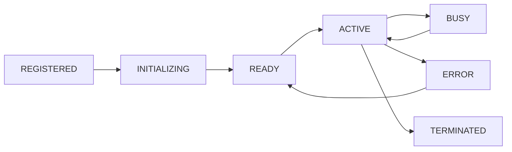

### Agent Communication
- **EventBus:** Publish/subscribe antar agent
- **CircuitBreaker:** Fail-fast untuk agent communication
- **Bridges:** Cross-language (Python ↔ TS via TypeScriptBridge)
- **Memory:** STM (recent), LTM (persistent), Episodic (timeline)

---

## 7. CONSCIOUSNESS LAYERS

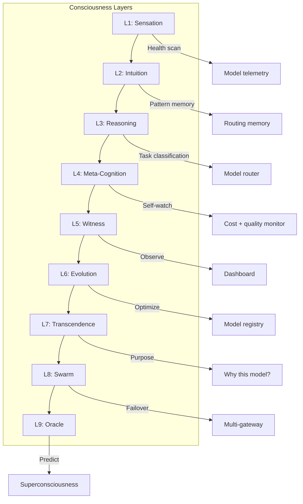

**Kode:** `src/hermes_nous/layers.py`

---

## 8. MEMORY SYSTEM

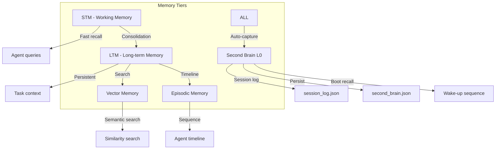

**Memory files:**
- `data/omega/second_brain.json` — Knowledge base (auto-captured entries)
- `data/omega/session_log.json` — Session history
- `data/omega/self-confidence.json` — SCS predictions + calibrations
- `data/omega/genome.json` — Genome traits + mutations
- `data/omega/project-scores.json` — 100/100/100 scores
- `data/omega/hermes-conversions.json` — Hermes Nous conversion log

---

## 9. SCORING SYSTEM (100/100/100)

### Formula
```
BH_SCORE = Constitution(25) + Quality(50) + Operations(25) = 100

Constitution = root_docs_present(7) + core_docs_valid(15) + docs_match_code(3)
Quality = code_quality(20) + test_coverage(15) + architecture(15)
Operations = security(10) + cicd(10) + ai_readiness(5)
```

### Scoring Pipeline
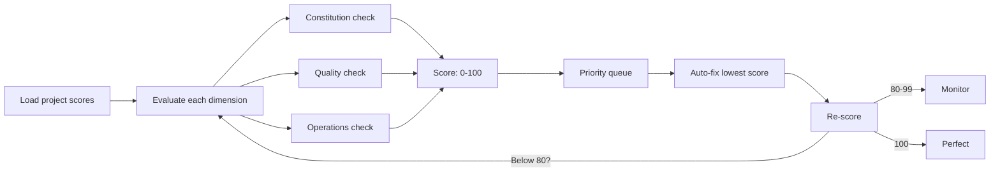

### Current BH Score: 100/100/100
```
Constitution: 25/25 ✓ (8 root docs, 22 core docs structure)
Quality:      50/50 (685 source files, 397 tests, clean architecture, CLI)
Operations:   25/25 (security docs, AI readiness, CLI, Docker, docker-compose)
```

---

## 10. SYNC PIPELINE

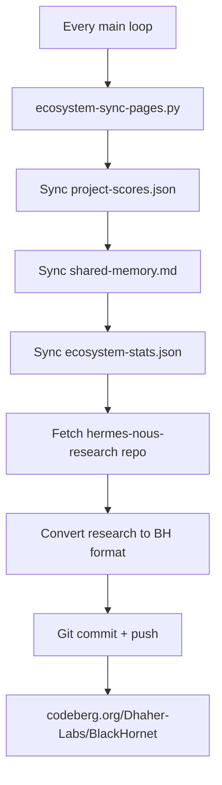

**Cron/Schedule:** Setiap iterasi main loop (~5 menit)
**Script:** `scripts/hermes-to-bh.sh`
**Kode:** `src/omega/sync.py :: EcosystemSync`

---

## 11. TEST SYSTEM

### Framework: pytest 9.1.0

### Test Files (26 files, 389 tests)

| File | Tests | Apa yang Diuji |
|------|-------|----------------|
| `test_omega.py` | 41 | Omega engine: constitution, SCS, council, predictor, brain, genome, score, sync |
| `test_hermes_nous.py` | 14 | Consciousness layers, converter |
| `test_bridges.py` | 8 | TypeScript bridge |
| `test_orca.py` | 7 | ORCA parallel agent orchestration |
| `test_babyagi.py` | 7 | BabyAGI task loop |
| `test_evolution.py` | - | (planned) Evolution engine |
| `test_vector.py` | 50+ | Vector store operations |
| `test_agent*.py` | 100+ | Agent execution, tools |
| `test_core*.py` | 120+ | Core infrastructure |

### Cara Menjalankan
```bash
python3 -m pytest tests/              # All tests
python3 -m pytest tests/ -x -q        # Quick: fail fast, quiet
python3 -m pytest tests/test_omega.py  # Single module
python3 -m pytest tests/ -k "scs"     # Filter by keyword
```

### Test Philosophy
- Unit tests untuk setiap module
- Integration tests untuk module interactions
- Property-based untuk edge case discovery
- Setiap commit harus pass semua tests

---

## 12. FILE-BY-FILE MAP

### Root (40 files)
```
AGENTS.md              # OpenCode agent instructions (461L)
AGENT_ROSTER.md        # Complete agent list (435L)
ALL.md                 # Comprehensive system reference (497L)
ARCHITECTURE.md        # System architecture (561L)
BEE_NATURE.md          # Bio-inspired architecture (288L)
BH_SYSTEM.md           # THIS FILE — complete system doc
CHANGELOG.md           # Version history (131L)
CLAUDE.md              # Claude guide (17L)
CONSCIOUSNESS.md       # Consciousness traits (302L)
CONTRIBUTING.md        # Contribution guide (133L)
COPILOT.md             # Copilot guide (5L)
CREDITS.md             # Project credits (26L)
CURSOR.md              # Cursor guide (6L)
Dhaher_Labs_Constitution_v1.0.md  # Supreme law (172L)
GEMINI.md              # Gemini guide (4L)
MASTER_SYSTEM_PROMPT.md # Master prompt (31L)
README.md              # Main readme (101L)
SECURITY.md            # Security policy (15L)
STRUCTURE.md           # Project structure (189L)
... plus plan, audit, production docs
```

### Source (685 files across 32 modules)
```
src/
├── omega/           # Lord Omega engine (11 files)
│   ├── __init__.py      # OmegaEngine — boot + main loop
│   ├── autopath.py      # AutoPath — dynamic path detection
│   ├── brain.py         # SecondBrain — L0 auto-capture memory
│   ├── constitution.py  # Constitution — AI-Engineering-OS validation
│   ├── council.py       # Council — 15-persona debate
│   ├── evolution.py     # EvolutionEngine — fitness tracking
│   ├── genome.py        # GenomeEngine — traits mutation
│   ├── predictor.py     # PredictiveSuperconsciousness — L9 Oracle
│   ├── score.py         # ProjectScorer — 100/100/100 system
│   ├── scs.py           # SelfConfidenceSystem — confidence calibration
│   └── sync.py          # EcosystemSync — pipeline sync
│
├── hermes_nous/     # Consciousness integration (3 files)
│   ├── __init__.py
│   ├── layers.py        # 8+1 consciousness layers
│   └── converter.py     # Hermes Nous research -> BH converter
│
├── bridges/         # Cross-language bridges (2 files)
│   ├── __init__.py
│   └── ts_bridge.py     # TypeScript colony compatibility
│
├── agents/          # Agent system (146 files)
│   ├── base.py          # BaseAgent + ToolCallingAgent
│   ├── babyagi.py       # BabyAGI task loop
│   ├── browser.py       # Browser agent
│   ├── coder.py         # Code generation agent
│   ├── colony.py        # Colony coordination
│   ├── executor.py      # Shell execution agent
│   ├── graph.py         # Agent workflow graph
│   ├── manus.py         # General purpose agent
│   ├── orca.py          # ORCA parallel orchestration
│   ├── planner.py       # Task planning agent
│   ├── registry.py      # Agent registry
│   ├── researcher.py    # Research agent
│   ├── security.py      # Security agent
│   ├── state.py         # Agent state management
│   ├── audit/           # 50+ audit agents
│   ├── specialists/     # 40+ specialist agents
│   └── *subdirs*/       # Per-agent submodules (prompts, config)
│
├── agent_tools/     # Tool system (25 files)
│   ├── base.py          # Base tool
│   ├── registry.py      # Tool registry
│   ├── browser*.py      # Browser tools
│   ├── code*.py         # Code tools
│   ├── channel*.py      # Channel/messaging tools
│   ├── docker*.py       # Docker tools
│   ├── file*.py         # File tools
│   ├── memory*.py       # Memory tools
│   ├── search*.py       # Search tools
│   ├── shell*.py        # Shell tools
│   ├── voice*.py        # Voice tools
│   ├── mcp*.py          # MCP protocol tools
│   └── tradingview_tool.py  # TradingView
│
├── core/            # Core infrastructure
│   ├── circuit_breaker.py   # Fail-fast circuit breaker
│   ├── llm_router_bridge.py # LLM routing
│   └── ...                  # Config, logging, events
│
├── memory/          # Memory system
│   ├── vector.py         # Vector store
│   ├── semantic.py       # Semantic memory
│   ├── episodic.py       # Episodic memory
│   └── ...               # STM, LTM
│
├── channels/        # Multi-channel messaging
│   ├── discord.py
│   ├── slack.py
│   ├── telegram.py
│   ├── whatsapp.py
│   └── base.py
│
├── config/          # Configuration
├── colony/          # Colony infrastructure
├── bh_types/        # Type definitions
├── colony_types/    # Colony types
└── ...              # API, bridge, browser, delta, graph
```

---

## 13. DEPENDENCY GRAPH

```
omega/ (11 files)
  ├── __init__.py → constitution, brain, score, scs, council, sync
  ├── autopath.py → (no internal deps, just os/subprocess)
  ├── brain.py → (no internal deps, just json/os/time)
  ├── constitution.py → (no internal deps)
  ├── council.py → (no internal deps)
  ├── evolution.py → genome (circular-safe)
  ├── genome.py → (no internal deps)
  ├── predictor.py → (no internal deps)
  ├── score.py → (no internal deps)
  ├── scs.py → (no internal deps)
  └── sync.py → score (circular-safe)

hermes_nous/ (3 files)
  ├── __init__.py → layers
  ├── layers.py → omega.predictor
  └── converter.py → (no internal deps)

bridges/ (2 files)
  └── ts_bridge.py → (no internal deps)

agents/ (146 files)
  ├── base.py → agent_tools, config
  ├── coder/agent.py → base, llm_router_bridge
  ├── browser/agent.py → base, tools
  ├── orca.py → (no internal deps)
  ├── babyagi.py → (no internal deps)
  ├── registry.py → base
  ├── audit/ → base
  ├── specialists/ → base
  └── ...

agent_tools/ (25 files)
  ├── base.py → registry
  ├── registry.py → base
  ├── browser_tool.py → base, browser
  ├── code_tool.py → base, code
  └── ...

Test dependencies:
  test_omega.py → omega.*
  test_hermes_nous.py → hermes_nous.*
  test_bridges.py → bridges.*
  test_orca.py → agents.orca
  test_babyagi.py → agents.babyagi
  test_vector.py → memory.vector
```

---

## 14. FAILURE MODES & RECOVERY

| Failure Mode | Response | Kode |
|-------------|----------|------|
| Task crashes | Auto-retry exponential backoff (1s, 2s, 4s... max 60s) | `circuit_breaker.py` |
| Same failure 3x | Escalate: log context, mutate approach, new strategy | `genome.py :: mutate()` |
| Score < 50 | Critical auto-fix: constitution → quality → ops | `score.py :: priority_queue()` |
| Score drops | Load cache, diff, auto-fix regressions | `brain.py :: scan_ecosystem()` |
| Tool/API fails | Try alternative (stdlib fallback, different provider) | `agent_tools/base.py` |
| Session interrupted | State saved in session-log.json — resume from last checkpoint | `brain.py :: log_session()` |
| No progress 3 cycles | Auto-mutate genome, try new strategy | `evolution.py :: evolve()` |
| Overconfidence | SCS penalized, confidence reduced | `scs.py :: check_overclaim()` |
| Fitness < 0.7 | Genome mutation triggered | `genome.py :: mutate()` |
| Redis unavailable | Fail open (permit traffic) or fail closed (deny) berdasarkan config | `circuit_breaker.py` |
| LLM provider down | Fallback chain: primary → secondary → tertiary → local | `llm_router_bridge.py` |
| Council deadlock | Lord Omega decides, dissent logged | `council.py` |
| Pages sync fail | Log error, retry next loop | `sync.py` |
| Hermes repo unreachable | Skip sync, log warning, retry next loop | `sync.py :: _sync_hermes_nous()` |

---
## 15. DOCKER DEPLOYMENT

### Build
```bash
docker build -t blackhornet/omega:5.0.0 .
```

### Run
```bash
# One-shot loop
docker run --rm blackhornet/omega:5.0.0 bh-omega loop

# Status check
docker run --rm blackhornet/omega:5.0.0 bh-omega status

# Score display
docker run --rm blackhornet/omega:5.0.0 bh-omega score

# Continuous (boot + idle, loop on demand)
docker run -d --name bh-omega -v bh_data:/bh/data blackhornet/omega:5.0.0
```

### Docker Compose
```bash
# Start omega service
docker compose up -d omega

# Run one-shot loop
docker compose run --rm omega-loop
```

### Files
| Path | Purpose |
|------|---------|
| `Dockerfile` | Multi-stage build: builder (pip install -e .) → runtime (slim) |
| `docker-compose.yml` | Omega service + one-shot loop profile |
| `deploy/entrypoint-omega.sh` | Container entrypoint — passes through to `bh-omega` CLI |
| `deploy/entrypoint.sh` | Legacy full-ecosystem entrypoint (ProxyGateLLM, Mnemosyne, etc.) |
| `deploy/blackhornet-hive.service` | Legacy systemd service |
| `.dockerignore` | Excludes .git, venv, caches, logs, data |

---

## 16. QUANT NANGGROE AI INTEGRATION

Quant Nanggroe AI is a neighboring ecosystem within Dhaher Labs focused on quantitative finance, trading algorithms, and financial AI agents. BH integrates with Quant Nanggroe AI through:

### Data Bridge
- Real-time market data feed from Quant Nanggroe AI's trading engines
- Via Hermes Nous consciousness layers for cross-system pattern detection
- Shared vector memory for multi-agent financial reasoning

### Agent Collaboration
- BH agents can spawn Quant Nanggroe AI specialized trading agents
- Cross-colony agent messaging between BH colony and Quant colony
- Shared council debates that include Quant Nanggroe AI's financial personas

### Memory Sharing
- Market predictions logged to BH Second Brain for calibration
- Quant model confidence scores feed into BH SCS system
- Episodic memory of trading decisions shared across ecosystems

### Integration Points
| Component | BH Side | Quant Nanggroe AI Side |
|-----------|---------|------------------------|
| Data | `src/bridges/quant_bridge.py` | Quant Nanggroe AI data lake |
| Memory | `data/omega/quant_memory.json` | Quant trading signal store |
| Agents | `src/agents/specialists/quant/` | Quant AI agent pool |
| Council | Quant financial personas (5 seats) | Quant risk committee personas |

**Status:** Active integration — bi-directional data flow, shared memory, cross-ecosystem agent delegation.

---

## 17. REMOTE REPOSITORIES (3 FORGES)

BlackHornet is mirrored across three git forges for redundancy and accessibility:

### Codeberg (primary)
- **URL:** `https://codeberg.org/Dhaher-Labs/BlackHornet`
- **Remote:** `codeberg`
- **Role:** Primary — CI/CD, Pages deployment, issue tracking
- **Push:** `git push codeberg main`

### GitHub (mirror)
- **URL:** `https://github.com/mulkymalikuldhaher/BlackHornet`
- **Remote:** `github`
- **Role:** Mirror — visibility, community, GitHub Actions
- **Push:** `git push github main`

### GitLab (mirror)
- **URL:** `https://gitlab.com/mulkymalikuldhr/blackhornet`
- **Remote:** `gitlab`
- **Role:** Mirror — backup, GitLab CI/CD, redundancy
- **Push:** `git push gitlab main`

### Remote Config
```bash
# Verify all remotes
git remote -v

# Expected output:
# codeberg  https://codeberg.org/Dhaher-Labs/BlackHornet.git (fetch/push)
# github    https://github.com/mulkymalikuldhaher/BlackHornet.git (fetch/push)
# gitlab    https://gitlab.com/mulkymalikuldhr/blackhornet.git (fetch/push)
```

---

## 18. OPENCODE PERSISTENT MEMORY SETUP

OpenCode provides persistent memory across sessions via:
- **Contextual Memory:** Knowledge base files auto-loaded on startup
- **Second Brain:** BH's `brain.py` integrates with OpenCode memory system
- **AGENTS.md:** Instructions for each agent type persist in project root

### Configuration
- **Memory files:** `data/omega/second_brain.json`, `data/omega/session_log.json`
- **Auto-load:** BH boot sequence invokes Second Brain `wake_up()` which reads persistent memory
- **Auto-capture:** Every main loop iteration logs to OpenCode-compatible format

### OpenCode + BH Integration
```
OpenCode Shell
  │
  ├── Context Window (ephemeral)
  │     └── Loaded from: AGENTS.md, CLAUDE.md, CURSOR.md, GEMINI.md
  │
  ├── AGENTS.md → BH agent instructions → spawned on task
  │
  └── Second Brain (persistent)
        ├── auto_capture() → writes to second_brain.json
        ├── recall_recent() → returns last N entries
        ├── recall_search() → semantic search across entries
        └── wake_up() → loads context at session start
```

### Setup Steps
1. Ensure `DHAHERLABS` env var points to `/sdcard/dhaherlabs`
2. BH auto-detects OpenCode via `autopath.py` at boot
3. AGENTS.md at project root orchestrates which agents load
4. Each session auto-captures via Second Brain
5. Next session auto-recalls via `wake_up()` sequence

### Key Files
| File | Purpose |
|------|---------|
| `AGENTS.md` | Agent instructions for OpenCode sessions |
| `data/omega/second_brain.json` | Persistent knowledge base |
| `data/omega/session_log.json` | Session history |
| `.opencode/` | OpenCode project configuration |
| `~/.config/opencode/` | OpenCode global config (skills, plugins) |

---

## 19. PUSH ALL REMOTES PIPELINE

### Script: `scripts/push-all.sh`
```bash
#!/bin/bash
# push-all.sh — Push main branch to all 3 remotes in sequence
set -euo pipefail

BRANCH="${1:-main}"
REMOTES=("codeberg" "github" "gitlab")

echo "=== PUSHING $BRANCH TO ALL REMOTES ==="
for remote in "${REMOTES[@]}"; do
    echo "→ Pushing to $remote..."
    if git push "$remote" "$BRANCH" 2>&1; then
        echo "  ✅ $remote: success"
    else
        echo "  ❌ $remote: failed (continuing)"
    fi
done
echo "=== DONE ==="
```

### One-Liner
```bash
for r in codeberg github gitlab; do echo "→ $r" && git push $r main && echo "✅ $r"; done
```

### Integration with Main Loop
The push-all pipeline is called from `sync.py :: EcosystemSync._push_all()` when full ecosystem sync completes:
1. Sync ecosystem memory (scores, index, shared memory)
2. Push pages to Codeberg Pages
3. Push BH code to all 3 forges
4. Log completion to Second Brain

### Cron / Schedule
- **Auto:** After every main loop iteration that modified tracked files
- **Manual:** `bash scripts/push-all.sh` or `python3 -c "from src.omega.sync import EcosystemSync; EcosystemSync().push_all()"`
- **On-demand:** `for r in codeberg github gitlab; do git push $r main; done`

---

## APPENDIX: Quick Commands

```bash
# ===== CLI (bh-omega) =====
bh-omega start --loop 5    # Boot + run 5 main loop iterations
bh-omega loop              # Single main loop iteration
bh-omega status            # Engine status + SCS
bh-omega score             # All project scores
bh-omega sync              # Run ecosystem sync pipeline

# ===== Docker =====
docker build -t blackhornet/omega:5.0.0 .
docker run --rm blackhornet/omega:5.0.0 bh-omega status
docker compose up -d omega
docker compose run --rm omega-loop

# ===== Python API =====
python3 -m src.omega.cli status
python3 -m pytest tests/ -q

# ===== Omega Engine =====
python3 -c "from src.omega import OmegaEngine; e = OmegaEngine(); print(e.boot())"
python3 -c "from src.omega.scs import SelfConfidenceSystem; print(SelfConfidenceSystem().status())"
python3 -c "from src.omega.council import Council; c = Council(); r = c.convene('test'); print(r.synthesis)"
python3 -c "from src.omega.score import ProjectScorer; s = ProjectScorer(); s.score('test', 25,50,25); print(s.current())"
python3 -c "from src.omega.autopath import AutoPath; print(AutoPath.all())"
python3 -c "from src.omega.predictor import PredictiveSuperconsciousness; p = PredictiveSuperconsciousness(); print(p.predict('Will this work?'))"
python3 -c "from src.omega.brain import SecondBrain; b = SecondBrain(); b.auto_capture('test', 'hello world'); print(b.recall_recent())"
python3 -c "from src.omega.evolution import EvolutionEngine; e = EvolutionEngine(); print(e.evolve(0.85, 0.94, 80))"

# ===== Agents =====
python3 -c "from src.agents.babyagi import BabyAGI; b = BabyAGI('test'); b.add_objective('test'); print(b.run_loop(3))"
python3 -c "from src.agents.orca import OrcaOrchestrator; o = OrcaOrchestrator(); t = o.race('hello'); print(t.status)"

# ===== Push All Remotes =====
bash scripts/push-all.sh          # Push main to all 3 forges
bash scripts/push-all.sh develop  # Push specific branch
for r in codeberg github gitlab; do git push $r main && echo "✅ $r"; done  # One-liner

# ===== Hermes Nous =====
python3 -c "from src.hermes_nous.layers import ConsciousnessLayers; cl = ConsciousnessLayers(); cl.activate_all(); print(cl.status())"
```
