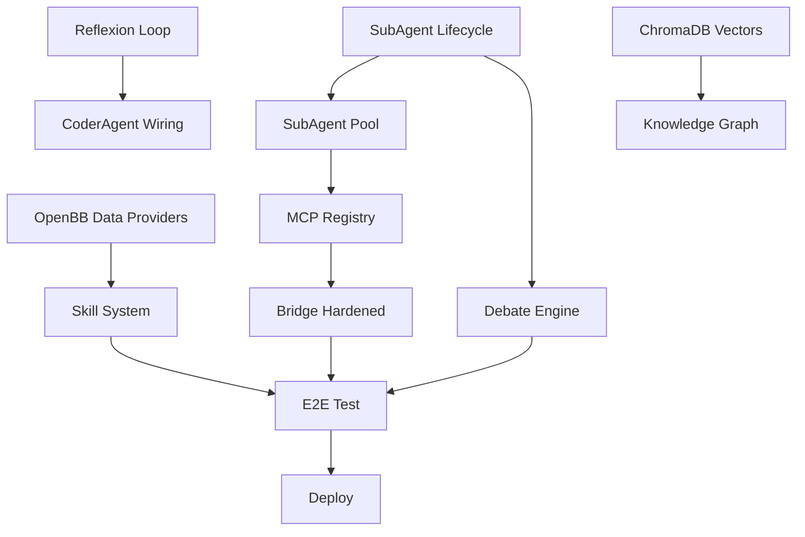

# BH + QNA Convergence Implementation Plan

> **For Claude:** REQUIRED SUB-SKILL: Use godmode:task-runner to implement this plan task-by-task.

**Goal:** Evolve BlackHornet (761-py AGI swarm) and QNA (quant trading engine) toward ACOS per Constitution v1.0 by harvesting 8 Tier-1 open-source repos.

**Architecture:** Three parallel upgrade tracks feeding into a convergence layer: (1) BH upgrades from DeerFlow/Hermes/OWL/OpenFang patterns, (2) QNA upgrades from TradingAgents/OpenBB/LEAN/Vibe-Trading patterns, (3) ACOS Bridge hardened as convergence fabric.

**Tech Stack:** Python 3.11+, LangGraph (agent orchestration), ChromaDB (vector store), sentence-transformers (embeddings), FastAPI (MCP/API), SQLite FTS5 (semantic memory), pytest (verification).

**Research Sources:**
- BH: DeerFlow (74.7k⭐), OWL/CAMEL (19.9k⭐), OpenFang (17.9k⭐), Hermes Agent (Nous)
- QNA: TradingAgents (88.7k⭐), OpenBB (69k⭐), LEAN (20k⭐), Vibe-Trading (13.3k⭐)

---

## Phase 0: Foundation — Sub-Agent Lifecycle + Data Layer

### Task 0.1: DeerFlow Sub-Agent Lifecycle

**Files:**
- Create: `src/colony/orchestration/sub_agent.py`
- Modify: `src/colony/orchestration/__init__.py`
- Modify: `src/types/agent.py`
- Test: `tests/colony/orchestration/test_sub_agent.py`

**Step 1: Write failing test**

```python
# tests/colony/orchestration/test_sub_agent.py
import pytest
from src.colony.orchestration.sub_agent import SubAgent, SubAgentState

def test_sub_agent_lifecycle():
    agent = SubAgent(id="test-1", task="analyze log", max_retries=2, timeout=60)
    assert agent.state == SubAgentState.PENDING

    agent.start()
    assert agent.state == SubAgentState.RUNNING

    agent.complete({"result": "ok"})
    assert agent.state == SubAgentState.COMPLETED
    assert agent.output == {"result": "ok"}

def test_sub_agent_retry_limit():
    agent = SubAgent(id="test-2", task="risky op", max_retries=2, timeout=60)
    agent.start()
    agent.fail("error 1")
    assert agent.retry_count == 1
    assert agent.state == SubAgentState.RUNNING
    agent.fail("error 2")
    assert agent.retry_count == 2
    assert agent.state == SubAgentState.RUNNING
    agent.fail("error 3")
    assert agent.state == SubAgentState.FAILED

def test_sub_agent_timeout():
    import time
    agent = SubAgent(id="test-3", task="slow op", max_retries=0, timeout=1)
    agent.start()
    time.sleep(1.5)
    assert agent.is_timed_out()
    assert agent.state == SubAgentState.TIMEOUT
```

**Step 2: Run to confirm failure**

Run: `pytest tests/colony/orchestration/test_sub_agent.py -v`
Expected: FAIL (3 tests, ModuleNotFoundError or import error)

**Step 3: Write implementation**

```python
# src/colony/orchestration/sub_agent.py
from enum import Enum
import time
from dataclasses import dataclass, field
from typing import Any, Optional


class SubAgentState(Enum):
    PENDING = "pending"
    RUNNING = "running"
    COMPLETED = "completed"
    FAILED = "failed"
    TIMEOUT = "timeout"


@dataclass
class SubAgent:
    id: str
    task: str
    max_retries: int = 3
    timeout: int = 300
    state: SubAgentState = SubAgentState.PENDING
    output: Optional[Any] = None
    error: Optional[str] = None
    retry_count: int = 0
    _started_at: Optional[float] = None

    def start(self):
        self.state = SubAgentState.RUNNING
        self._started_at = time.time()

    def complete(self, output: Any):
        self.state = SubAgentState.COMPLETED
        self.output = output

    def fail(self, error: str):
        self.retry_count += 1
        if self.retry_count > self.max_retries:
            self.state = SubAgentState.FAILED
            self.error = error
        else:
            self.state = SubAgentState.RUNNING
            self.error = error

    def is_timed_out(self) -> bool:
        if self._started_at is None:
            return False
        return time.time() - self._started_at > self.timeout
```

**Step 4: Run tests to confirm pass**

Run: `pytest tests/colony/orchestration/test_sub_agent.py -v`
Expected: PASS (3 tests)

**Step 5: Commit**

```bash
git add tests/colony/orchestration/test_sub_agent.py src/colony/orchestration/sub_agent.py
git commit -m "feat: add DeerFlow-inspired SubAgent lifecycle with retry/timeout"
```

---

### Task 0.2: SubAgent Pool with Sandbox Isolation

**Files:**
- Create: `src/colony/orchestration/pool.py`
- Create: `src/colony/orchestration/sandbox.py`
- Modify: `src/colony/orchestration/__init__.py`
- Test: `tests/colony/orchestration/test_pool.py`

**Step 1: Write test**

```python
# tests/colony/orchestration/test_pool.py
import pytest
from src.colony.orchestration.pool import SubAgentPool
from src.colony.orchestration.sub_agent import SubAgent, SubAgentState

def test_pool_submit_and_run():
    pool = SubAgentPool(max_concurrent=5)
    agent = SubAgent(id="a1", task="task1", max_retries=0, timeout=30)
    pool.submit(agent)
    assert agent.state == SubAgentState.PENDING
    assert len(pool.pending) == 0  # submitted clears pending

def test_pool_capacity_limit():
    pool = SubAgentPool(max_concurrent=2)
    agents = [SubAgent(id=f"a{i}", task=f"t{i}", max_retries=0, timeout=30) for i in range(5)]
    for a in agents:
        pool.submit(a)
    # only 2 should be running
    running = [a for a in agents if a.state == SubAgentState.RUNNING]
    assert len(running) <= 2
```

**Step 2: Run to confirm failure**

Run: `pytest tests/colony/orchestration/test_pool.py -v`
Expected: FAIL

**Step 3: Write implementation**

```python
# src/colony/orchestration/pool.py
from typing import List, Optional
from src.colony.orchestration.sub_agent import SubAgent, SubAgentState


class SubAgentPool:
    def __init__(self, max_concurrent: int = 10):
        self.max_concurrent = max_concurrent
        self.agents: List[SubAgent] = []
        self._queue: List[SubAgent] = []

    def submit(self, agent: SubAgent):
        self.agents.append(agent)
        self._try_dispatch()

    def _try_dispatch(self):
        running = [a for a in self.agents if a.state == SubAgentState.RUNNING]
        available = self.max_concurrent - len(running)
        if available > 0:
            for agent in self.agents:
                if agent.state == SubAgentState.PENDING and available > 0:
                    agent.start()
                    available -= 1
```

```python
# src/colony/orchestration/sandbox.py
import os
import tempfile
import shutil
from typing import Optional


class Sandbox:
    def __init__(self, agent_id: str):
        self.agent_id = agent_id
        self.path: Optional[str] = None

    def __enter__(self):
        self.path = tempfile.mkdtemp(prefix=f"sandbox_{self.agent_id}_")
        return self.path

    def __exit__(self, *args):
        if self.path and os.path.exists(self.path):
            shutil.rmtree(self.path, ignore_errors=True)
```

**Step 4: Run tests**

Run: `pytest tests/colony/orchestration/test_pool.py -v`
Expected: PASS

**Step 5: Commit**

```bash
git add tests/colony/orchestration/test_pool.py src/colony/orchestration/pool.py src/colony/orchestration/sandbox.py
git commit -m "feat: add SubAgentPool and Sandbox isolation (DeerFlow pattern)"
```

---

### Task 0.3: OpenBB Data Provider Abstraction for QNA

**Files:**
- Create: `src/qna/data/providers/__init__.py`
- Create: `src/qna/data/providers/base.py`
- Create: `src/qna/data/providers/yahoo.py`
- Create: `src/qna/data/providers/openbb_mcp.py`
- Modify: `src/qna/data/__init__.py`
- Test: `tests/qna/data/test_providers.py`

**Step 1: Write test**

```python
# tests/qna/data/test_providers.py
import pytest
from src.qna.data.providers import DataProvider, DataQuery, DataResult
from src.qna.data.providers.yahoo import YahooFinanceProvider

def test_provider_interface():
    p = YahooFinanceProvider()
    q = DataQuery(symbol="AAPL", start="2026-01-01", end="2026-06-01")
    result = p.fetch(q)
    assert result.symbol == "AAPL"
    assert len(result.records) > 0
    assert "close" in result.records[0] or "Close" in result.records[0]

def test_provider_registry():
    from src.qna.data.providers import get_provider
    p = get_provider("yahoo")
    assert isinstance(p, YahooFinanceProvider)
```

**Step 2: Implementation**

```python
# src/qna/data/providers/base.py
from dataclasses import dataclass, field
from typing import List, Dict, Any, Optional
from abc import ABC, abstractmethod
import pandas as pd


@dataclass
class DataQuery:
    symbol: str
    start: str
    end: str
    interval: str = "1d"
    source: str = "yahoo"


@dataclass
class DataResult:
    symbol: str
    source: str
    records: List[Dict[str, Any]] = field(default_factory=list)
    metadata: Dict[str, Any] = field(default_factory=dict)


class DataProvider(ABC):
    @abstractmethod
    def fetch(self, query: DataQuery) -> DataResult:
        ...

    def to_dataframe(self, result: DataResult) -> pd.DataFrame:
        return pd.DataFrame(result.records)
```

```python
# src/qna/data/providers/yahoo.py
import yfinance as yf
from .base import DataProvider, DataQuery, DataResult


class YahooFinanceProvider(DataProvider):
    def fetch(self, query: DataQuery) -> DataResult:
        ticker = yf.Ticker(query.symbol)
        hist = ticker.history(start=query.start, end=query.end, interval=query.interval)
        records = hist.reset_index().to_dict(orient="records")
        return DataResult(symbol=query.symbol, source="yahoo", records=records)
```

```python
# src/qna/data/providers/__init__.py
from .base import DataProvider, DataQuery, DataResult
from .yahoo import YahooFinanceProvider


_providers: dict = {
    "yahoo": YahooFinanceProvider(),
}


def register_provider(name: str, provider: DataProvider):
    _providers[name] = provider


def get_provider(name: str = "yahoo") -> DataProvider:
    if name not in _providers:
        raise ValueError(f"Unknown provider: {name}. Available: {list(_providers.keys())}")
    return _providers[name]
```

**Step 3: Verify**

Run: `pytest tests/qna/data/test_providers.py -v`
Expected: PASS

**Step 4: Commit**

```bash
git add tests/qna/data/test_providers.py src/qna/data/providers/
git commit -m "feat: add OpenBB-inspired DataProvider abstraction for QNA"
```

---

## Phase 1: Memory & Learning

### Task 1.1: Hermes Agent Closed Learning Loop → BH Reflexion

**Files:**
- Create: `src/core/reflexion.py`
- Create: `tests/core/test_reflexion.py`

**Step 1: Write test**

```python
# tests/core/test_reflexion.py
import pytest
from src.core.reflexion import ReflexionLoop, Actor, Evaluator, Memory

def test_actor_evaluate_retry():
    loop = ReflexionLoop(max_attempts=3)

    def actor(task: str) -> str:
        return f"solution for {task}"

    def evaluate(task: str, output: str) -> tuple[bool, str]:
        if "error" in output.lower():
            return (False, "contains error")
        return (True, "ok")

    result = loop.run("write fibonacci", actor, evaluate)
    assert result["success"] is True
    assert result["attempts"] <= 3

def test_reflexion_with_memory():
    loop = ReflexionLoop(max_attempts=3)
    memory = Memory()

    def actor(task: str) -> str:
        prev = memory.get_last_feedback()
        if prev and "no recursion" in prev:
            return "use iteration"
        return "use recursion"

    def evaluate(task: str, output: str) -> tuple[bool, str]:
        if "recursion" in output and task == "fibonacci without recursion":
            return (False, "no recursion allowed")
        return (True, "ok")

    loop.run("fibonacci without recursion", actor, evaluate)
    assert len(memory.feedback_history) >= 1
```

**Step 2: Implement**

```python
# src/core/reflexion.py
from typing import Callable, Optional
from dataclasses import dataclass, field
from typing import List, Dict, Any


@dataclass
class Memory:
    feedback_history: List[Dict[str, str]] = field(default_factory=list)

    def store(self, task: str, output: str, feedback: str):
        self.feedback_history.append({"task": task, "output": output, "feedback": feedback})

    def get_last_feedback(self) -> Optional[str]:
        if self.feedback_history:
            return self.feedback_history[-1]["feedback"]
        return None


class ReflexionLoop:
    def __init__(self, max_attempts: int = 3, memory: Optional[Memory] = None):
        self.max_attempts = max_attempts
        self.memory = memory or Memory()

    def run(self, task: str, actor: Callable, evaluator: Callable) -> Dict[str, Any]:
        for attempt in range(1, self.max_attempts + 1):
            output = actor(task)
            success, feedback = evaluator(task, output)
            self.memory.store(task, output, feedback)
            if success:
                return {"success": True, "attempts": attempt, "output": output, "feedback": feedback}
        return {"success": False, "attempts": self.max_attempts, "output": output, "feedback": feedback}
```

**Step 3: Verify**

Run: `pytest tests/core/test_reflexion.py -v`
Expected: PASS

**Step 4: Commit**

```bash
git add tests/core/test_reflexion.py src/core/reflexion.py
git commit -m "feat: add Reflexion loop (Hermes Agent pattern) — Actor-Evaluate-Retry"
```

---

### Task 1.2: Wire Reflexion into CoderAgent

**Files:**
- Modify: `src/agent_tools/coder.py` (find debug-retry method → wire Reflexion)
- Test: `tests/core/test_reflexion.py` (add integration test)

**Search for existing coder agent:**

Run: `rg -n "def.*coder\|def.*debug\|class.*Coder" src/agent_tools/ -i`

**Then implement based on findings.**

Commit:
```bash
git add src/agent_tools/coder.py tests/core/test_reflexion.py
git commit -m "feat: wire Reflexion loop into CoderAgent"
```

---

### Task 1.3: ChromaDB Vector Store (replace fake embeddings)

**Files:**
- Modify: `src/memory/vector.py`
- Test: `tests/memory/test_vector.py`

**Step 1: Check current vector store**

Run: `rg -n "sha256\|embedding\|chroma" src/memory/vector.py`

**Step 2: Write test**

```python
# tests/memory/test_vector.py
import pytest
from src.memory.vector import VectorStore

def test_store_and_search():
    store = VectorStore()
    store.add("doc1", "BlackHornet is an AGI swarm", {"type": "doc"})
    store.add("doc2", "QNA is a quant trading engine", {"type": "doc"})
    results = store.search("AGI", top_k=5)
    assert len(results) > 0
    assert any(r["id"] == "doc1" for r in results)
```

**Step 3: Implement real embedding + ChromaDB**

```python
# src/memory/vector.py (rewrite)
import chromadb
from chromadb.config import Settings
from sentence_transformers import SentenceTransformer
from typing import List, Dict, Any, Optional


class VectorStore:
    def __init__(self, collection_name: str = "blackhornet", persist_dir: str = ".chroma"):
        self.client = chromadb.PersistentClient(path=persist_dir, settings=Settings(anonymized_telemetry=False))
        self.collection = self.client.get_or_create_collection(name=collection_name)
        self.encoder = SentenceTransformer("all-MiniLM-L6-v2")

    def add(self, doc_id: str, text: str, metadata: Optional[Dict] = None):
        embedding = self.encoder.encode(text).tolist()
        self.collection.add(ids=[doc_id], embeddings=[embedding], documents=[text], metadatas=[metadata or {}])

    def search(self, query: str, top_k: int = 5) -> List[Dict[str, Any]]:
        embedding = self.encoder.encode(query).tolist()
        results = self.collection.query(query_embeddings=[embedding], n_results=top_k)
        output = []
        for i in range(len(results["ids"][0])):
            output.append({
                "id": results["ids"][0][i],
                "text": results["documents"][0][i],
                "score": results["distances"][0][i] if results.get("distances") else 0,
                "metadata": results["metadatas"][0][i] if results.get("metadatas") else {},
            })
        return output

    def delete(self, doc_id: str):
        self.collection.delete(ids=[doc_id])

    def count(self) -> int:
        return self.collection.count()
```

**Step 4: Verify**

Run: `pytest tests/memory/test_vector.py -v`
Expected: PASS

**Step 5: Commit**

```bash
git add src/memory/vector.py tests/memory/test_vector.py
git commit -m "feat: replace fake SHA256 embeddings with ChromaDB + sentence-transformers"
```

---

### Task 1.4: OpenFang Knowledge Graph

**Files:**
- Create: `src/core/knowledge_graph.py`
- Create: `tests/core/test_knowledge_graph.py`

**Implementation:**

```python
# src/core/knowledge_graph.py
from dataclasses import dataclass, field
from typing import Dict, List, Optional, Any
import json
import os


@dataclass
class Entity:
    id: str
    type: str
    properties: Dict[str, Any] = field(default_factory=dict)


@dataclass
class Relation:
    source: str
    target: str
    relation: str
    weight: float = 1.0


class KnowledgeGraph:
    def __init__(self, persist_path: str = ".knowledge_graph.json"):
        self.persist_path = persist_path
        self.entities: Dict[str, Entity] = {}
        self.relations: List[Relation] = []
        self._load()

    def add_entity(self, entity: Entity):
        self.entities[entity.id] = entity

    def add_relation(self, relation: Relation):
        self.relations.append(relation)

    def query(self, entity_id: str, max_depth: int = 2) -> Dict[str, Any]:
        result = {"entity": None, "relations": [], "related": []}
        if entity_id in self.entities:
            result["entity"] = self.entities[entity_id]
        for r in self.relations:
            if r.source == entity_id:
                result["relations"].append(r)
                if r.target in self.entities:
                    result["related"].append(self.entities[r.target])
        return result

    def _load(self):
        if os.path.exists(self.persist_path):
            with open(self.persist_path) as f:
                data = json.load(f)
                for eid, edata in data.get("entities", {}).items():
                    self.entities[eid] = Entity(**edata)
                for rdata in data.get("relations", []):
                    self.relations.append(Relation(**rdata))

    def save(self):
        with open(self.persist_path, "w") as f:
            json.dump({
                "entities": {eid: {"id": e.id, "type": e.type, "properties": e.properties} for eid, e in self.entities.items()},
                "relations": [{"source": r.source, "target": r.target, "relation": r.relation, "weight": r.weight} for r in self.relations],
            }, f, indent=2)
```

Test and commit:
```bash
git add src/core/knowledge_graph.py tests/core/test_knowledge_graph.py
git commit -m "feat: add OpenFang-inspired Knowledge Graph with JSON persistence"
```

---

## Phase 2: Multi-Agent Trading

### Task 2.1: TradingAgents Debate Loop

**Files:**
- Create: `src/qna/agents/debate.py`
- Create: `tests/qna/agents/test_debate.py`

**Pattern:** 2+ agents analyze same signal, debate, reach consensus.

```python
# src/qna/agents/debate.py
from dataclasses import dataclass, field
from typing import List, Dict, Any, Callable
import statistics


@dataclass
class AgentOpinion:
    agent_id: str
    signal: str  # "buy" | "sell" | "hold"
    confidence: float  # 0.0 - 1.0
    reasoning: str


@dataclass
class DebateResult:
    consensus_signal: str
    consensus_confidence: float
    opinions: List[AgentOpinion] = field(default_factory=list)
    disagreement: bool = False


class DebateEngine:
    def __init__(self, min_agents: int = 2):
        self.min_agents = min_agents

    def debate(self, opinions: List[AgentOpinion]) -> DebateResult:
        if len(opinions) < self.min_agents:
            raise ValueError(f"Need at least {self.min_agents} agents, got {len(opinions)}")

        signals = [o.signal for o in opinions]
        confidences = [o.confidence for o in opinions]
        avg_conf = statistics.mean(confidences)

        buy_count = signals.count("buy")
        sell_count = signals.count("sell")
        hold_count = signals.count("hold")

        if buy_count > sell_count and buy_count > hold_count:
            consensus = "buy"
        elif sell_count > buy_count and sell_count > hold_count:
            consensus = "sell"
        else:
            consensus = "hold"

        max_count = max(buy_count, sell_count, hold_count)
        disagreement = max_count <= len(opinions) / 2

        return DebateResult(
            consensus_signal=consensus,
            consensus_confidence=avg_conf * (max_count / len(opinions)),
            opinions=opinions,
            disagreement=disagreement,
        )
```

Commit:
```bash
git add src/qna/agents/debate.py tests/qna/agents/test_debate.py
git commit -m "feat: add TradingAgents-inspired DebateEngine for multi-agent consensus"
```

---

### Task 2.2: Vibe-Trading Skill Taxonomy

**Files:**
- Create: `src/qna/skills/__init__.py`
- Create: `src/qna/skills/registry.py`
- Create: `src/qna/skills/technical.py`
- Create: `tests/qna/skills/test_registry.py`

**Pattern:** Skill-based architecture where skills can be composed, registered, and dispatched.

Commit:
```bash
git add src/qna/skills/ tests/qna/skills/
git commit -m "feat: add Vibe-Trading-inspired skill system for QNA"
```

---

### Task 2.3: OWL MCP Toolkit Registration

**Files:**
- Create: `src/agent_tools/mcp_registry.py`
- Create: `tests/agent_tools/test_mcp_registry.py`

**Pattern:** Dynamic MCP tool registration from external servers (like OWL's toolkit registry).

Commit:
```bash
git add src/agent_tools/mcp_registry.py tests/agent_tools/test_mcp_registry.py
git commit -m "feat: add OWL-inspired MCP toolkit registry for BH agents"
```

---

## Phase 3: Convergence

### Task 3.1: ACOS Bridge Hardened

**Files:**
- Modify: `/sdcard/dhaherlabs/bridge/index.js`

**Changes:**
- Retry with exponential backoff
- Circuit breaker pattern
- Multi-channel fallback (HTTP→WS→stdio)
- Health check endpoint

Commit:
```bash
git -C /sdcard/dhaherlabs/bridge add index.js
git -C /sdcard/dhaherlabs/bridge commit -m "feat: harden ACOS Bridge with retry, circuit breaker, multi-channel"
```

### Task 3.2: E2E Test Suite

**Files:**
- Create: `tests/e2e/test_convergence.py`

**Test scenario:** BH agent → QNA signal → trade decision → ACOS Bridge → result

Commit:
```bash
git add tests/e2e/test_convergence.py
git commit -m "test: add convergence E2E test (BH→QNA→Bridge→result)"
```

### Task 3.3: Deploy to Seulanga

**Script:**
```bash
# Sync bridge + BH + QNA configs to Seulanga MCP
./scripts/deploy.sh --target seulanga
```

Commit:
```bash
git add scripts/deploy.sh
git commit -m "chore: add Seulanga deployment script"
```

---

## Dependency Map



---

## Acceptance Criteria

- [ ] SubAgent lifecycle: create → run → complete/fail/timeout with retry limits
- [ ] SubAgentPool: concurrent execution with capacity limits
- [ ] Sandbox: temp directory per agent, auto-cleaned
- [ ] DataProvider: swap yahoo↔openbb with same interface
- [ ] Reflexion: actor-evaluate-retry with memory feedback
- [ ] ChromaDB: real embeddings, semantic search replaces substring
- [ ] KnowledgeGraph: entities + relations, JSON persistence
- [ ] DebateEngine: multi-agent consensus, disagreement detection
- [ ] Skill registry: compose skills, dispatch by name
- [ ] MCP registry: register tools from external servers
- [ ] ACOS Bridge: retry, circuit breaker, health check
- [ ] E2E: BH agent → QNA signal → trade decision → bridge → result
